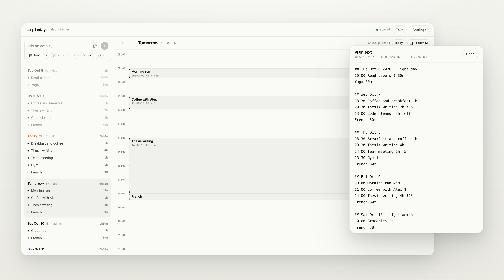

# SimpleDay

A minimal day planner: your week at a glance, your day hour by hour.

SimpleDay has a clean week overview shows what's
coming, an hour-by-hour plan shows exactly how today fits together, and an optional Telegram
reminder reaches your phone when it's time. Underneath, your whole plan is plain text, so it stays
fast, portable and private.

**Live:** https://simpleday.pages.dev



## Features

- **Week and day views.** See the week's days at a glance, then open any day
  as an hour-by-hour plan.
- **Reminders on Telegram**, right at the start time by default.
- **Calendar import.** Bring in events from Google Calendar, Apple Calendar or
  Outlook with an `.ics` file.
- **No account and no sign-up.** SimpleDay works offline and installs on
  your phone like an app.
- **Plain text as the ground truth.** Everything you planned is stored as editable plain text
  (see [The text format](#the-text-format)).
- **Private.** Your plan stays in your browser. Sync between devices and
  reminders go through your own free Cloudflare worker.

## How do I use SimpleDay?

SimpleDay works right away in your browser at https://simpleday.pages.dev.
To get reminders on your phone and sync your plan between devices, follow the
three steps below. They match **Settings → Setup guide** in the app.

### 1. Create your Telegram bot

1. In Telegram, open **@BotFather** and send `/newbot`.
2. Pick a name and username. BotFather replies with your **bot token**. Paste
   it into SimpleDay → Settings → **Bot token**.
3. Open your new bot's chat and send it any message (e.g. "hi").
4. Back in SimpleDay, press **Detect** next to **Chat ID**.

### 2. Set up your reminder server

Reminders are sent by a small Cloudflare Worker in your own free Cloudflare
account. No card is needed. Pick **one** of the two methods; both end with the
same worker.

<table>
<tr>
<th width="50%">Method A · In the browser</th>
<th width="50%">Method B · Command line</th>
</tr>
<tr>
<td valign="top">

Works on a phone or a computer. Nothing to install.

1. Sign up at [dash.cloudflare.com](https://dash.cloudflare.com/sign-up).
2. **Storage & Databases → KV → Create**. Name it `simpleday`.
3. **Workers & Pages → Create → Start with Hello World**. Name it
   `simpleday` and press **Deploy**.
4. Press **Edit code**, delete everything, paste the SimpleDay worker code
   and press **Deploy**. Get the code from the **Copy worker code** button
   in the app's setup guide, or from [`worker/worker.js`](worker/worker.js).
5. Back on the worker: **Bindings → Add binding → KV namespace**. Variable
   name `SIMPLEDAY` (capitals), namespace `simpleday`. Save.
6. **Settings → Trigger events → Add → Cron triggers**, every minute
   (`* * * * *`). Save.
7. Copy the worker's address (it ends in `.workers.dev`).

</td>
<td valign="top">

Needs a computer with [Node.js](https://nodejs.org) and
[git](https://git-scm.com).

1. Get the project: `git clone https://github.com/xiaohanp/simple_day.git`,
   or **Code → Download ZIP** on GitHub.
2. In the project folder, run:
   ```bash
   npm install -g wrangler
   wrangler login       # opens Cloudflare in your browser
   cd worker
   cp wrangler.example.toml wrangler.toml
   wrangler kv namespace create SIMPLEDAY
   ```
3. Paste the printed `id` into `wrangler.toml`, replacing
   `PASTE_YOUR_KV_NAMESPACE_ID_HERE`.
4. Run `wrangler deploy`. It sets up the every-minute trigger for you.
5. Copy the worker address it prints (it ends in `.workers.dev`).

</td>
</tr>
</table>

Then, for either method: paste the address into SimpleDay → Settings →
**Worker URL** and press **Send test notification**. A message should arrive
in Telegram.

### 3. Install SimpleDay on your phone

Open https://simpleday.pages.dev on your phone and add it to your home screen.
It then opens full screen like a normal app and works offline.

- **Android (Chrome):** tap the **⋮** menu → **Install app** (on some phones
  it's **Add to Home screen**).
- **iPhone / iPad (Safari):** tap **Share** (the square with an arrow) →
  **Add to Home Screen** → **Add**.

### Using another device or a new address

Open Settings there and enter the **same Worker URL and Secret key** as on your
first device. The secret key is generated the first time you open the app, so
keep it somewhere safe. Anyone with both your worker URL and key can read and
change your plan.

## Develop SimpleDay

Requires Node.js 20+.

```bash
npm install
npm run dev
npm run build      # type-check + production build into dist/
npm run lint
```

### Deploying the web app

The app is a static site, hosted on Cloudflare Pages:

```bash
npm run build
wrangler pages deploy dist --project-name simpleday --branch main
```

The first run creates the Pages project. Deploy to the production branch you
chose there (`main`), so the site goes live at `https://<project>.pages.dev`
instead of a preview URL.

### Deploying the worker

Only needed when `worker/worker.js` or `worker/wrangler.toml` changes:

```bash
cd worker
wrangler deploy
```

`worker/wrangler.toml` holds your own KV namespace ID and is git-ignored.
`worker/wrangler.example.toml` is the template.

## Privacy

There's no SimpleDay server. Your plan is stored in your browser's local
storage. If you set up reminders, it's also stored in your worker's KV storage
in your own Cloudflare account, together with your Telegram bot token. Nothing
is sent anywhere else, apart from the reminder messages to Telegram.

## The text format

<details>
<summary>How a plan is written as plain text</summary>

Under the hood, a plan is plain text. Open the text panel in the app to read or
edit it directly; the views and the text always stay in sync.

```text
## Thu Oct 8 2026 — writing day
09:00 Thesis writing 4h          fixed start, lasts 4 hours
French 30m                       floating: starts when the previous item ends
09:00-13:00 Deep work            fixed start and end
14:00 Call with Anna 1h !10      remind 10 minutes before
16:00 Gym !off                   no reminder
Buy milk                         no time at all, just a task

## tomorrow
08:30 Standup                    reminder right at 08:30 (the default)
```

| You write                                                                          | Meaning                                                                |
| ---------------------------------------------------------------------------------- | ---------------------------------------------------------------------- |
| `## 2026-10-08`, `## Thu Oct 8`, `## October 8th, 2026`, `## today`, `## tomorrow` | Starts a day. Anything after the date (e.g. `— light day`) is a label. |
| `09:00 …` / `09:00-13:00 …`                                                        | Fixed start time (and optional end).                                   |
| `30m`, `1h`, `1.5h`, `2h15m`                                                       | Duration.                                                              |
| `!10`, `!1h`                                                                       | Reminder that many minutes or hours before the start.                  |
| `!off`                                                                             | No reminder for this item.                                             |
| `@ Room 204`                                                                       | Optional location, written at the end of the line.                     |
| Lines before the first `##` heading                                                | Inbox: things not yet scheduled.                                       |

Only items with a time get reminders.

</details>
